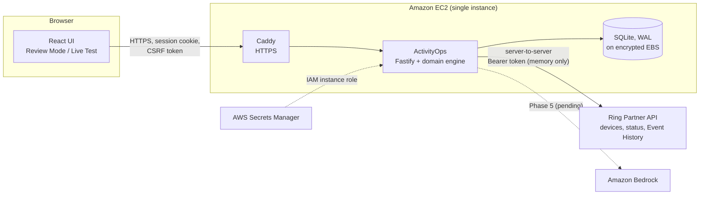

# ActivityOps

**Opening, closing and shift-handover checks for small business sites — with Ring evidence, operator
decisions, and an audit trail of what still needs action.**

> ActivityOps records the check, the Ring evidence, the operator decision, and what still needs
> action.

Built for the Amazon Developer Hackathon 2026 — **Ring track**, AWS Builder mini challenge.

---

## The problem

A store manager opening up at 7am works through a checklist: walk the entrance, check the alarm
panel, count the float. Today that is a paper sheet or a tick in a spreadsheet. Nobody can later
show *that a check happened when it was meant to*, what failed, whether it was rechecked, or who
decided the site was ready.

ActivityOps turns that checklist into an accountable record:

1. A **verification run** (opening, closing, handover) lists required and optional checks.
2. For a Ring-backed check, the operator opens **Ring live view**. ActivityOps then syncs Ring
   **Event History** and binds the live-view session record to that check — one record, one check.
3. The **operator decides PASS or FAIL**. A PASS on a Ring-backed check is refused until a qualifying
   session has been observed; a FAIL is always allowed.
4. A FAIL opens an **incident**. A recheck is a new, immutable attempt — the failure is never
   overwritten. Resolving the incident takes a named person.
5. Readiness is **computed deterministically** from all of the above, with a plain-language
   explanation of what is blocking it.

## What the Ring evidence does — and does not — mean

A Ring `on_demand` record is a **live-view session record**. ActivityOps calls it
*"Ring session observed during this check window"* and, on every evidence card, lists what it does
**not** establish: who started the session, what was seen, or that an area was clear. The operator's
attestation is the business decision. ActivityOps never says "person detected", "motion detected",
"site clear" or "site safe" — a test fails the build if any of those phrases appear in the UI.

## Judge Test — 5 Minutes

> **Hosted URL:** not yet live — see [Known limitations](#known-limitations). Until it is, run the
> app locally in about two minutes with [Run it locally](#run-it-locally).

1. **Open the app.** No sign-in is needed for Review Mode.
2. **Open the recorded run** under *Review Mode* — "Opening readiness", labelled
   **RECORDED DEMO — Ring Playground capture: 2026-10-07**.
3. **Inspect the Ring evidence card** on *Front entrance live-view walkthrough*. The session is a real
   record captured from the Ring Developer Playground, marked **SIMULATED**, with its limits listed.
4. **Inspect attempt #1 and recheck attempt #2** on *Alarm panel* (*Show all 2 attempts*). The FAIL
   is still there; the PASS supersedes it.
5. **Inspect the incident lifecycle** under *Incidents* → *Lifecycle*: OPEN → ACKNOWLEDGED →
   ACTION_REQUIRED → RECHECKING → READY_TO_RESOLVE → RESOLVED. Steps driven by an attempt are
   attributed to *system*; resolution was approved by a person.
6. **Notice the override** on *Previous shift notes*: shown as **OVERRIDDEN**, never as a PASS.
7. **AI handover note** — *not yet available* (see Known limitations).
8. **View the audit trail** at the bottom of the run.
9. *Optional, Live Test:* **Sign in** (credentials below), tick the data-practices notice, paste a
   fresh **Ring Developer Playground** OAuth token, and connect. ActivityOps discovers however many
   devices the account has and builds a live checklist from them.
10. Start a run, **Start Ring check**, open Ring live view in the Playground, then **Sync Ring
    history** to bind the session and unlock PASS.

The interface always distinguishes **RECORDED DEMO**, **LIVE PLAYGROUND**, **SIMULATED** and
**RECONNECT REQUIRED** (shown when Ring sync is unavailable — which is never treated as evidence
about the site).

### Demo credentials

| Where | Username | Password |
|---|---|---|
| Hosted demo | `demo.operator` | Published here when the hosted instance goes live |
| Local development | `demo.operator` | `activityops-dev-only` (the server refuses this value in production) |

## Architecture



- **Ring adapter** — built to the response contract *measured* against the live API, not assumed:
  JSON:API envelope, epoch-millisecond timestamps, device binding via `relationships.source`.
  Every response is schema-validated; a malformed response is an integration error, never an empty
  result.
- **Client-side filtering is authoritative.** Our Day-1 test showed the Playground ignores the
  `event_types` filter, so ActivityOps filters every response by device and event type itself.
- **Evidence matching** — a session counts only if it is on the check's device, is `on_demand`,
  starts inside `[armed − 30s, armed + window]`, and has not been claimed by another check
  (a database `UNIQUE` constraint).
- **Integration failures are never evidence.** A `401`, timeout or malformed response raises a
  *Reconnect needed* banner and changes nothing else. A missing session becomes a blocker only after
  the window has expired *and* a complete history sync covered it.
- **Immutability is structural.** Database triggers refuse any update or delete of an attested
  attempt; the run has no status column — readiness is always derived.

## Ring and AWS technologies used

| Technology | Use | Status |
|---|---|---|
| Ring Partner API — `GET /v1/devices`, `/v1/devices/{id}/status`, `/v1/history/devices/{id}/events` | Device discovery, availability, Event History sync | **Used at runtime** in Live Test Mode |
| Ring Developer Playground | One-click OAuth tokens; validation gate; judge Live Test | **Used** |
| Ring live view (WHEP) | Operators open live view in the Playground, in a separate tab | Designed in; **not exercised** — the Playground device was offline throughout testing. No embedded video |
| Ring media / snapshot APIs | — | **Deliberately never called** by the readiness workflow |
| Amazon EC2 + encrypted Amazon EBS + Docker Compose + Caddy | Hosting; SQLite on a persistent encrypted volume | Container stack built and verified locally; **not yet deployed** |
| IAM instance role, AWS Secrets Manager | No long-lived keys on the host; password from Secrets Manager | Runbook and script written; **not yet deployed** |
| Amazon Bedrock, Strands Agents | Read-only operations copilot (handover notes, explanations) | **Not yet built** — awaiting model access |
| Amazon CloudWatch | Log shipping | Logs proven free of secrets; not yet connected |

## Privacy and data handling

The full notice is in the app under **Data practices**, generated from the deployment's real
configuration. In short:

- **Collected:** device names and online status; Event History record type, times and opaque ids for
  a device while a check runs. **No video, snapshots or audio** are requested or stored.
- **Stored:** normalized facts only — never raw Ring responses. The Ring access token lives in
  server memory for the session only: never in the database, logs, the browser, or a URL. Tests dump
  every database table and capture real log output to prove it.
- **Bedrock:** nothing is sent while the AI assistant is not configured, and the notice says so.
- **Training:** Ring-derived data is never used to train any model.
- **Deletion:** *Delete All Data* removes every run, attempt, Ring fact, incident and audit entry,
  ends the Ring connection, and keeps one record that a deletion happened.
- **Workplace monitoring:** live view can capture employees or the public; give notice and obtain
  any consent local law requires before real use.

ActivityOps is an operations workflow tool. It is not a life-safety, emergency, medical,
law-enforcement or security-guarantee system.

## Security

Single login with an httpOnly, SameSite=Strict (and, in production, Secure) session cookie;
synchronizer-token CSRF protection; rate limits on login, Ring connect, Ring sync and deletion;
strict Content-Security-Policy; anonymous visitors can read only the recorded demo. Production
refuses to start without a strong password. The container runs as a non-root user with a read-only
root filesystem and all Linux capabilities dropped. Six of these guards are mutation-tested:
deliberately disabling any one of them makes the test suite fail.

## Known limitations

Stated plainly, so nothing here is mistaken for something it is not:

- **Not yet hosted.** The deployment is designed and verified in local Docker, but no AWS account was
  available during the build, so there is no public URL yet.
- **No AI assistant yet.** The Bedrock / Strands handover copilot (Phase 5) is waiting on model
  access. Review Mode therefore has no AI handover artifact.
- **The Playground device was offline** throughout testing, so no fresh live-view session could be
  generated. The recorded run uses the one real session record that was captured.
- **Unmeasured timing.** Provider indexing delay could not be measured, so the post-window wait
  (60 s) and clock-skew allowance (30 s) are conservative defaults, explicitly not tuned.
- **Pagination is unverified against Ring.** It is tested against synthetic multi-page fixtures; the
  test account never held enough events to span pages.
- **One login.** There is no role separation, so the operator and the approver can be the same
  person. The UI never implies two-person control.
- **Live view opens in a separate tab.** Embedded WebRTC/WHEP video is a production follow-up.

Every one of these is tracked with its evidence in
[`docs/activityops/RISKS_AND_BLOCKERS.md`](docs/activityops/RISKS_AND_BLOCKERS.md).

## Run it locally

Requires **Node.js 24** — the API uses Node's built-in `node:sqlite` driver, and Node 24 is the only
version this has been tested on (CI and the container image use it too).

```bash
npm install
npm run dev:api        # API on http://127.0.0.1:8787, seeds the recorded demo run
npm run dev:web        # UI on http://localhost:5173
```

Open <http://localhost:5173> — use `localhost`, not `127.0.0.1`: the Vite dev server may listen on
IPv6 only. Review Mode works immediately; sign in with the local credentials above for Live Test.

```bash
npm test               # 183 tests
npm run typecheck
node scripts/scan-secrets.mjs --history
```

**Production container:**

```bash
docker build -t activityops-app .
docker run --rm -p 8080:8080 -e DEMO_PASSWORD='<12+ characters>' -v activityops-data:/data activityops-app
```

AWS deployment: [`deploy/README.md`](deploy/README.md).

### Configuration

All settings are environment variables, documented in [`.env.example`](.env.example). The ones that
matter most:

| Variable | Purpose |
|---|---|
| `DEMO_PASSWORD` | Sign-in password. Required (12+ characters) in production |
| `DATABASE_PATH` | SQLite file; on EC2 this lives on the encrypted EBS volume |
| `RING_API_BASE_URL` | Ring Partner API base (`https://api.amazonvision.com`) |
| `SESSION_WINDOW_SECONDS` / `DEMO_SESSION_WINDOW_SECONDS` | How long after arming a session can count (600 / 300) |
| `CLOCK_SKEW_ALLOWANCE_SECONDS` | Grace before arming, for clock mismatch only (30) |
| `BEDROCK_MODEL_ID`, `AWS_REGION` | AI assistant — unset until model access is confirmed |

## How this was built

The project was built in gated phases against a written specification, and every decision, test
result, integration finding and mistake was recorded as it happened:

| Record | Contents |
|---|---|
| [Integration findings](docs/activityops/INTEGRATION_FINDINGS.md) | What the real Ring API did on Day 1 |
| [Decisions](docs/activityops/DECISIONS.md) | Every design decision and correction, with reasons |
| [Test results](docs/activityops/TEST_RESULTS.md) | Every suite, plus what the tests do *not* prove |
| [Lessons learned](docs/activityops/LESSONS_LEARNED.md) | Mistakes and near-misses, including a security bug we found in our own code |
| [Build status](docs/activityops/BUILD_STATUS.md) | Phase-by-phase status |

**Feedback for the Ring and AWS teams:** [PRODUCT_FEEDBACK.md](PRODUCT_FEEDBACK.md) and
[FRICTION_LOG.md](FRICTION_LOG.md).

## Licence

MIT — see [LICENSE](LICENSE).
